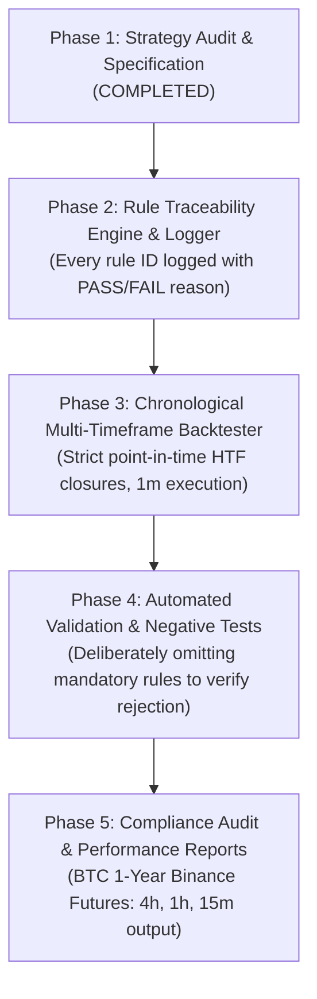

# STRATEGY SPECIFICATION & ARCHITECTURAL AUDIT

> **System Name:** Institutional Multi-Timeframe Algorithmic Trading System (Top G / Atul Patil Structure Engine)  
> **Target Asset:** BTCUSDT (Binance Futures)  
> **Source Codebase:** `htf_engine.py`, `ltf_approach_engine.py`, `mtf_strategy.py`, `portfolio_risk_manager.py`, `timeframe_allocation_manager.py`, `server.py`  
> **Audit Status:** Phase 1 Complete — Single Source of Truth Formalization  

---

## 1. System Architecture & Timeframe Dependencies

The strategy is a multi-timeframe system operating across three concurrent configurations for `BTCUSDT`:

| Profile ID | HTF (Structure & Zones) | LTF (Approach & Entry) | Category | Max Bar Latency | Primary RR Model |
| :--- | :--- | :--- | :--- | :--- | :--- |
| **TF-H4** | **4-Hour (4h)** | **5-Minute (5m)** | Macro Swing | 14,400s (4h) | Fixed 3.0:1 R:R |
| **TF-H1** | **1-Hour (1h)** | **1-Minute (1m)** | Intermediate Swing | 3,600s (1h) | Opposing HTF Liquidity ($\ge 2.5\text{R}$) |
| **TF-M15** | **15-Minute (15m)** | **1-Minute (1m)** | Structural Trend | 900s (15m) | Opposing HTF Liquidity ($\ge 2.5\text{R}$) |

---

## 2. Comprehensive Strategy Rule Inventory

### Category 1: HTF Market Structure & Swing Detection Rules

#### Rule `HTF-001`: Bearish 2-Candle Retracement (2RTR Swing High Confirmation)
- **Source File & Function:** [`htf_engine.py:run()`](file:///c:/Users/PMLS/Downloads/Python%20Indicator/htf_engine.py#L212-L215)
- **Required Timeframe:** HTF (4h, 1h, 15m)
- **Mandatory / Optional:** Mandatory
- **Logical Condition:**
  ```python
  is_red1 = candle[i-1]["close"] < candle[i-1]["open"]
  is_red2 = candle[i]["close"] < candle[i]["open"]
  bearish_pullback = is_red1 and is_red2 and (candle[i]["close"] < candle[i-1]["low"])
  ```
- **Dependencies:** Requires at least 2 closed HTF candles.
- **Action on Pass:** Validates active swing peak (`Point C`), confirms valid Higher Low (`confirmed_hl`), and sets `waiting_for_2rtr = False`.
- **Invalidation:** Single green candle, neutral doji, or candle failing to close below prior low resets the pullback search.
- **Behavior on Failure:** Swing peak remains unconfirmed; Point C is not updated.

#### Rule `HTF-002`: Bullish 2-Candle Retracement (2RTR Swing Low Confirmation)
- **Source File & Function:** [`htf_engine.py:run()`](file:///c:/Users/PMLS/Downloads/Python%20Indicator/htf_engine.py#L216-L219)
- **Required Timeframe:** HTF (4h, 1h, 15m)
- **Mandatory / Optional:** Mandatory
- **Logical Condition:**
  ```python
  is_green1 = candle[i-1]["close"] > candle[i-1]["open"]
  is_green2 = candle[i]["close"] > candle[i]["open"]
  bullish_pullback = is_green1 and is_green2 and (candle[i]["close"] > candle[i-1]["high"])
  ```
- **Dependencies:** Requires at least 2 closed HTF candles.
- **Action on Pass:** Validates active swing trough (`Point C`), confirms valid Lower High (`confirmed_lh`), and sets `waiting_for_2rtr = False`.
- **Invalidation:** Single red candle, neutral doji, or candle failing to close above prior high resets the pullback search.
- **Behavior on Failure:** Swing trough remains unconfirmed; Point C is not updated.

#### Rule `HTF-003`: Bullish Break of Structure (BOS)
- **Source File & Function:** [`htf_engine.py:run()`](file:///c:/Users/PMLS/Downloads/Python%20Indicator/htf_engine.py#L834-L922)
- **Required Timeframe:** HTF (4h, 1h, 15m)
- **Mandatory / Optional:** Mandatory
- **Logical Condition:**
  ```python
  trend == 1 and point_c_active and point_c_val is not None and candle[i]["close"] > point_c_val
  ```
- **Dependencies:** `trend == 1` (Uptrend active), confirmed `point_c_val` via `HTF-001`.
- **Action on Pass:**
  - Resets `consecutive_choch_count = 0`.
  - Sets `has_bos_after_choch = True`.
  - Emits green solid BOS line at `point_c_val`.
  - Creates **TJL1** (Demand base) and **TJL2** (Pullback base).
  - Sets `waiting_for_2rtr = True` to search for next swing high.
- **Invalidation:** Price reversing below confirmed HL before breaking Point C triggers Single CHoCH (`HTF-005`).
- **Behavior on Failure:** Trend continuation remains unconfirmed.

#### Rule `HTF-004`: Bearish Break of Structure (BOS)
- **Source File & Function:** [`htf_engine.py:run()`](file:///c:/Users/PMLS/Downloads/Python%20Indicator/htf_engine.py#L923-L1011)
- **Required Timeframe:** HTF (4h, 1h, 15m)
- **Mandatory / Optional:** Mandatory
- **Logical Condition:**
  ```python
  trend == -1 and point_c_active and point_c_val is not None and candle[i]["close"] < point_c_val
  ```
- **Dependencies:** `trend == -1` (Downtrend active), confirmed `point_c_val` via `HTF-002`.
- **Action on Pass:**
  - Resets `consecutive_choch_count = 0`.
  - Sets `has_bos_after_choch = True`.
  - Emits red solid BOS line at `point_c_val`.
  - Creates **TJL1** (Supply base) and **TJL2** (Pullback base).
  - Sets `waiting_for_2rtr = True` to search for next swing low.
- **Invalidation:** Price reversing above confirmed LH before breaking Point C triggers Single CHoCH (`HTF-006`).
- **Behavior on Failure:** Trend continuation remains unconfirmed.

#### Rule `HTF-005`: Bearish Single Change of Character (Single CHoCH, Count = 1)
- **Source File & Function:** [`htf_engine.py:run()`](file:///c:/Users/PMLS/Downloads/Python%20Indicator/htf_engine.py#L524-L606)
- **Required Timeframe:** HTF (4h, 1h, 15m)
- **Mandatory / Optional:** Mandatory
- **Logical Condition:**
  ```python
  trend == 1 and confirmed_hl_active and confirmed_hl_val is not None and \
  candle[i-1]["close"] < confirmed_hl_val and candle[i]["close"] < confirmed_hl_val
  ```
- **Dependencies:** Active uptrend (`trend == 1`), confirmed Higher Low pivot (`confirmed_hl_val`).
- **Action on Pass:**
  - Flips trend to downtrend: `trend = -1`.
  - Increments `consecutive_choch_count = 1`.
  - Prior TJL1 transforms to **A+** candidate box.
  - Prior TJL2 transforms to **SBR** (Support Becomes Resistance) Supply box.
  - Origin swing transforms to **QML** (Quasimodo Supply Level).
  - Extreme peak transforms to **Double Top (DT)**.
  - Sets `dual_choch_active = True`, targeting previous `point_c_val`.
- **Invalidation:** If next break is a bearish BOS (`HTF-004`), CHoCH is confirmed and counter resets.
- **Behavior on Failure:** Uptrend remains intact.

#### Rule `HTF-006`: Bullish Single Change of Character (Single CHoCH, Count = 1)
- **Source File & Function:** [`htf_engine.py:run()`](file:///c:/Users/PMLS/Downloads/Python%20Indicator/htf_engine.py#L681-L763)
- **Required Timeframe:** HTF (4h, 1h, 15m)
- **Mandatory / Optional:** Mandatory
- **Logical Condition:**
  ```python
  trend == -1 and confirmed_lh_active and confirmed_lh_val is not None and \
  candle[i-1]["close"] > confirmed_lh_val and candle[i]["close"] > confirmed_lh_val
  ```
- **Dependencies:** Active downtrend (`trend == -1`), confirmed Lower High pivot (`confirmed_lh_val`).
- **Action on Pass:**
  - Flips trend to uptrend: `trend = 1`.
  - Increments `consecutive_choch_count = 1`.
  - Prior TJL1 transforms to **A+** candidate box.
  - Prior TJL2 transforms to **RBS** (Resistance Becomes Support) Demand box.
  - Origin swing transforms to **QML** (Quasimodo Demand Level).
  - Extreme trough transforms to **Double Bottom (DB)**.
  - Sets `dual_choch_active = True`, targeting previous `point_c_val`.
- **Invalidation:** If next break is a bullish BOS (`HTF-003`), CHoCH is confirmed and counter resets.
- **Behavior on Failure:** Downtrend remains intact.

#### Rule `HTF-007`: Dual CHoCH ("A+ Setup", Count = 2)
- **Source File & Function:** [`htf_engine.py:run()`](file:///c:/Users/PMLS/Downloads/Python%20Indicator/htf_engine.py#L259-L435)
- **Required Timeframe:** HTF (4h, 1h, 15m)
- **Mandatory / Optional:** Mandatory (Identified on HTF, but filtered out at execution per Rule `RISK-005`)
- **Logical Condition:**
  ```python
  dual_choch_active and not has_bos_after_choch and dual_choch_target_val is not None and \
  candle[i-1]["close"] > dual_choch_target_val and candle[i]["close"] > dual_choch_target_val  # (or < for bearish)
  ```
- **Dependencies:** Previous Single CHoCH (`HTF-005` or `HTF-006`) without an intervening BOS.
- **Action on Pass:**
  - Increments `consecutive_choch_count = 2`.
  - Re-flips trend back to prior direction.
  - Spawns "Level of 3" and "Level of 4" boxes.
- **Invalidation:** A valid BOS resets structure.
- **Behavior on Failure:** Single CHoCH remains active.

#### Rule `HTF-008`: Triple CHoCH (Chop & Compression, Count = 3)
- **Source File & Function:** [`htf_engine.py:run()`](file:///c:/Users/PMLS/Downloads/Python%20Indicator/htf_engine.py#L436-L507)
- **Required Timeframe:** HTF (4h, 1h, 15m)
- **Mandatory / Optional:** Mandatory
- **Logical Condition:**
  ```python
  consecutive_choch_count == 2 and level_of_4_active and \
  candle[i-1]["close"] < level_of_4_val and candle[i]["close"] < level_of_4_val  # (or > for bullish)
  ```
- **Dependencies:** Dual CHoCH active (`HTF-007`) without an intervening BOS.
- **Action on Pass:** Flags market as ranging consolidation; renders purple "Triple CHoCH" line.
- **Invalidation:** BOS breakout resets state.
- **Behavior on Failure:** Dual CHoCH remains active.

---

### Category 2: HTF Zone Qualification & Mitigation Rules

#### Rule `ZONE-001`: Qualifying HTF Zone Filter
- **Source File & Function:** [`htf_engine.py:is_qualifying_htf_zone()`](file:///c:/Users/PMLS/Downloads/Python%20Indicator/htf_engine.py#L5-L25)
- **Required Timeframe:** HTF (4h, 1h, 15m)
- **Mandatory / Optional:** Mandatory
- **Logical Condition:**
  ```python
  name = str(box.get("text", "")).upper()
  # Must NOT be A+ (Dual CHoCH)
  if "A+" in name:
      return False
  # Must be one of the validated Top G institutional levels:
  return any(k in name for k in [
      "TJL1", "TJL 1",
      "TJL2", "TJL 2",
      "QML", "QUASIMODO",
      "RBS", "SBR",
      "DOUBLE TOP", "DOUBLE BOTTOM",
      "LEVEL OF 3", "LEVEL OF 4"
  ])
  ```
- **Dependencies:** Zone created by `HTFEngine`.
- **Action on Pass:** Zone is eligible to be tracked and tapped.
- **Invalidation / Failure:** Zone is discarded; never evaluated for trade entry.

#### Rule `ZONE-002`: Zone Active & Formation Timeline Check
- **Source File & Function:** [`htf_engine.py:is_htf_box_active()`](file:///c:/Users/PMLS/Downloads/Python%20Indicator/htf_engine.py#L27-L48)
- **Required Timeframe:** HTF & LTF Decision Time
- **Mandatory / Optional:** Mandatory
- **Logical Condition:**
  ```python
  left = box.get("confirmed_formation_time") or box.get("left") or 0
  if current_decision_time < left:
      return False  # Look-ahead prevention: zone has not yet formed in historical time
  ```
- **Dependencies:** Bar timestamp tracking.
- **Action on Pass:** Zone exists at decision time.
- **Invalidation / Failure:** Zone cannot be referenced before its confirmed formation bar close.

#### Rule `ZONE-003`: Institutional 2-Candle Mitigation Invalidation
- **Source File & Function:** [`htf_engine.py:is_htf_box_active()`](file:///c:/Users/PMLS/Downloads/Python%20Indicator/htf_engine.py#L42-L46)
- **Required Timeframe:** HTF
- **Mandatory / Optional:** Mandatory
- **Logical Condition:**
  ```python
  if box.get("is_mitigated") or box.get("is_broken"):
      mit_time = box.get("mitigated_time") or box.get("right")
      if mit_time and current_decision_time >= mit_time:
          return False
  ```
  A Demand zone is mitigated when two consecutive HTF candles close below the zone bottom (`close < box_bottom`). A Supply zone is mitigated when two consecutive HTF candles close above the zone top (`close > box_top`).
- **Dependencies:** HTF candle close evaluation.
- **Action on Pass:** Zone remains active.
- **Invalidation / Failure:** Zone is marked DEAD/MITIGATED; permanently excluded from subsequent trade generation.

---

### Category 3: Multi-Timeframe Alignment & Approach Rules

#### Rule `MTF-001`: Multi-Timeframe Pairing Constraint
- **Source File & Function:** [`timeframe_allocation_manager.py:get_allowed_execution_profiles()`](file:///c:/Users/PMLS/Downloads/Python%20Indicator/timeframe_allocation_manager.py#L167-L173)
- **Required Timeframe:** Cross-Timeframe
- **Mandatory / Optional:** Mandatory
- **Logical Condition:**
  ```python
  valid_pairs = {
      ("4h", "5m"),
      ("1h", "1m"),
      ("15m", "1m")
  }
  (htf_tf, ltf_tf) in valid_pairs
  ```
- **Dependencies:** Symbol configuration.
- **Action on Pass:** Data streams synchronized.
- **Invalidation / Failure:** Non-compliant timeframe pairs are rejected.

#### Rule `MTF-002`: Pre-Tap Counter-Trend Approach Direction [DEACTIVATED / REMOVED]
- **Status:** REMOVED per user instruction.
- **Source File & Function:** [`ltf_approach_engine.py:compute_ltf_approach_structure()`](file:///c:/Users/PMLS/Downloads/Python%20Indicator/ltf_approach_engine.py)
- **Required Timeframe:** LTF (1m or 5m)
- **Mandatory / Optional:** Deactivated (Formerly Mandatory)
- **Description:** Previous requirement for a counter-trend BOS/CHoCH in the 40 bars prior to zone tap has been removed. Price may enter the zone from any prior structural condition.

#### Rule `MTF-003`: Valid Tap Entry Direction [DEACTIVATED / REMOVED]
- **Status:** REMOVED per user instruction.
- **Source File & Function:** [`ltf_approach_engine.py:is_valid_tap_approach()`](file:///c:/Users/PMLS/Downloads/Python%20Indicator/ltf_approach_engine.py)
- **Required Timeframe:** LTF
- **Mandatory / Optional:** Deactivated (Formerly Mandatory)
- **Description:** Previous directional constraint (Demand tapped only from above; Supply tapped only from below) has been removed. Any candle intersecting the zone boundary (`low <= box_top and high >= box_bottom`) qualifies as a valid tap.

#### Rule `MTF-004`: 120-Candle Reaction Cycle State Machine (First Tap vs. Retest)
- **Source File & Function:** [`ltf_approach_engine.py:compute_ltf_approach_structure()`](file:///c:/Users/PMLS/Downloads/Python%20Indicator/ltf_approach_engine.py), [`server.py:ZONE_CYCLE_REGISTRY`](file:///c:/Users/PMLS/Downloads/Python%20Indicator/server.py), [`faithful_backtest_engine.py:zone_cycles`](file:///c:/Users/PMLS/Downloads/Python%20Indicator/faithful_backtest_engine.py)
- **Required Timeframe:** LTF
- **Mandatory / Optional:** Mandatory
- **Logical Condition:**
  - When price enters a qualifying HTF zone from the outside, a **Reaction Cycle** opens, recording `initial_tap_time` and `initial_box`.
  - The cycle remains active for a duration of **120 LTF candles** (`120 * ltf_sec`, e.g., 10 hours on M5, 2 hours on M1) or until the zone is mitigated/invalidated.
  - While active, all subsequent retest evaluations anchor back to `initial_tap_time` via `override_tap_time`.
  - This decouples the **Setup Phase** (initial tap $\rightarrow$ localized CHoCH / 5-wave race condition $\rightarrow$ intermediate level generation: QML, SBR/RBS, DT/DB) from the **Execution Phase** (subsequent retest $\rightarrow$ candlestick confirmation trigger).
- **Dependencies:** `MTF-002`, `MTF-003`, `ZONE-001`, `ZONE-002`, `ZONE-003`.
- **Action on Pass:** Post-tap CHoCH and internal levels are preserved across retests, enabling valid trade triggers within the 120-candle window.
- **Invalidation / Failure:** Cycle expires after 120 LTF candles, or closes if the zone is fully breached/mitigated; new tap required to initiate new cycle.

---

### Category 4: LTF Race Condition & Structural Reaction Rules

#### Rule `LTF-001`: The Race Condition (5-Wave Internal vs. Localized CHoCH)
- **Source File & Function:** [`ltf_approach_engine.py:compute_ltf_approach_structure()`](file:///c:/Users/PMLS/Downloads/Python%20Indicator/ltf_approach_engine.py#L2081-L2101)
- **Required Timeframe:** LTF post-tap window (up to 240 bars)
- **Mandatory / Optional:** Mandatory
- **Logical Condition:**
  ```python
  w5_time = res_5w["wave_5_time"] if res_5w["completed"] else float('inf')
  earliest_choch_time = earliest_post_tap_choch_time
  
  if w5_time < earliest_choch_time:
      winner = "5-Wave (Internal)"
      cutoff_time = w5_time
  elif earliest_choch_time < float('inf'):
      winner = f"{earliest_choch_type} (External)"
      cutoff_time = earliest_choch_time
  else:
      winner = "NONE"  # Race in progress or incomplete
  ```
- **Dependencies:** Zone tap confirmed (`MTF-002`, `MTF-003`).
- **Action on Pass:** Establishes `cutoff_time` and active retest levels:
  - If 5-Wave wins: activates **Level of 3** and **Level of 4**.
  - If CHoCH wins: activates **QML**, **SBR/RBS**, **Double Top/Bottom**.
- **Invalidation / Failure:** If neither pathway completes within 240 bars, setup expires without entry.

#### Rule `LTF-002`: Internal 5-Wave Formation Criteria
- **Source File & Function:** [`ltf_approach_engine.py:detect_internal_5_waves()`](file:///c:/Users/PMLS/Downloads/Python%20Indicator/ltf_approach_engine.py#L43-L110)
- **Required Timeframe:** LTF
- **Mandatory / Optional:** Mandatory for 5-Wave Pathway
- **Logical Condition:**
  - Wave 1 starts strictly from the deepest extreme wick of the HTF zone touch.
  - Wave 2 retracement cannot exceed the origin of Wave 1 (no new zone extreme).
  - Wave 3 must break the extreme of Wave 1.
  - Wave 4 retracement cannot enter the price territory of Wave 1.
  - Wave 5 must break the extreme of Wave 3.
- **Dependencies:** Candlestick high/low progression.
- **Action on Pass:** Sets `res_5w["completed"] = True`.
- **Invalidation / Failure:** 5-Wave pathway discarded; falls back to CHoCH pathway.

---

### Category 5: Candlestick Pattern Trigger Rules

#### Rule `CANDLE-001`: Retest Boundary Constraint
- **Source File & Function:** [`ltf_approach_engine.py:scan_ltf_trade_entry()`](file:///c:/Users/PMLS/Downloads/Python%20Indicator/ltf_approach_engine.py#L1685-L1705)
- **Required Timeframe:** LTF post-cutoff
- **Mandatory / Optional:** Mandatory
- **Logical Condition:**
  - For BUY: `min(pattern_candles["low"]) <= box_top + buffer`
  - For SELL: `max(pattern_candles["high"]) >= box_bot - buffer`
  - The candlestick reversal pattern must form inside or directly touching the HTF zone boundary.
- **Dependencies:** Qualified active level from `LTF-001`.
- **Action on Pass:** Candlestick pattern eligible for trigger.
- **Invalidation / Failure:** Patterns forming in mid-air away from the zone are ignored.

#### Rule `CANDLE-002`: Bullish Engulfing Pattern
- **Source File & Function:** [`pattern_scanner.py:is_valid_bullish_engulfing()`](file:///c:/Users/PMLS/Downloads/Python%20Indicator/pattern_scanner.py#L15-L35)
- **Required Timeframe:** LTF
- **Mandatory / Optional:** Option A for Bullish Trigger
- **Logical Condition:**
  ```python
  c_prev["close"] < c_prev["open"] and \
  c_curr["close"] > c_curr["open"] and \
  c_curr["close"] >= c_prev["open"] and \
  c_curr["open"] <= c_prev["close"] and \
  abs(c_curr["close"] - c_curr["open"]) > abs(c_prev["close"] - c_prev["open"])
  ```
- **Dependencies:** Candle must touch an active Level of 3, Level of 4, QML, RBS, or Double Bottom.
- **Action on Pass:** Generates BUY entry signal on candle close.

#### Rule `CANDLE-003`: Bearish Engulfing Pattern
- **Source File & Function:** [`pattern_scanner.py:is_valid_bearish_engulfing()`](file:///c:/Users/PMLS/Downloads/Python%20Indicator/pattern_scanner.py#L38-L58)
- **Required Timeframe:** LTF
- **Mandatory / Optional:** Option A for Bearish Trigger
- **Logical Condition:**
  ```python
  c_prev["close"] > c_prev["open"] and \
  c_curr["close"] < c_curr["open"] and \
  c_curr["close"] <= c_prev["open"] and \
  c_curr["open"] >= c_prev["close"] and \
  abs(c_curr["close"] - c_curr["open"]) > abs(c_prev["close"] - c_prev["open"])
  ```
- **Dependencies:** Candle must touch an active Level of 3, Level of 4, QML, SBR, or Double Top.
- **Action on Pass:** Generates SELL entry signal on candle close.

#### Rule `CANDLE-004`: Morning Star Pattern (3-Candle)
- **Source File & Function:** [`ltf_approach_engine.py:scan_ltf_trade_entry()`](file:///c:/Users/PMLS/Downloads/Python%20Indicator/ltf_approach_engine.py#L1636-L1662)
- **Required Timeframe:** LTF
- **Mandatory / Optional:** Option B for Bullish Trigger
- **Logical Condition:**
  - Candle 1: Strong red candle (`close < open`).
  - Candle 2: Small body star (`body < c1_body and body < c3_body`).
  - Candle 3: Strong green candle closing at or above midpoint of Candle 1 body (`close >= (open_1 + close_1)/2`).
- **Dependencies:** Any 1 of the 3 candles touches the active level.
- **Action on Pass:** Generates BUY entry signal on Candle 3 close.

#### Rule `CANDLE-005`: Evening Star Pattern (3-Candle)
- **Source File & Function:** [`ltf_approach_engine.py:scan_ltf_trade_entry()`](file:///c:/Users/PMLS/Downloads/Python%20Indicator/ltf_approach_engine.py#L1664-L1676)
- **Required Timeframe:** LTF
- **Mandatory / Optional:** Option B for Bearish Trigger
- **Logical Condition:**
  - Candle 1: Strong green candle (`close > open`).
  - Candle 2: Small body star (`body < c1_body and body < c3_body`).
  - Candle 3: Strong red candle closing at or below midpoint of Candle 1 body (`close <= (open_1 + close_1)/2`).
- **Dependencies:** Any 1 of the 3 candles touches the active level.
- **Action on Pass:** Generates SELL entry signal on Candle 3 close.

---

### Category 6: Risk Management & Order Execution Rules

#### Rule `RISK-001`: Institutional $0.5 \times \text{ATR}_{15M}$ Stop Loss Cushion
- **Source File & Function:** [`ltf_approach_engine.py:scan_ltf_trade_entry()`](file:///c:/Users/PMLS/Downloads/Python%20Indicator/ltf_approach_engine.py#L1739-L1778)
- **Required Timeframe:** Computed from 15M candles (`period = 14`)
- **Mandatory / Optional:** Mandatory
- **Logical Condition:**
  $$\text{ATR}_{15M} = \frac{1}{14} \sum_{k=1}^{14} \text{TR}_k, \quad \text{where } \text{TR} = \max(\text{High}-\text{Low}, |\text{High}-\text{Close}_{\text{prev}}|, |\text{Low}-\text{Close}_{\text{prev}}|)$$
  $$\text{Cushion} = \max(0.5 \times \text{ATR}_{15M}, \text{MinTick})$$
  - **BUY SL:** $\text{SL} = \min(\text{Pattern Lows}) - \text{Cushion}$
  - **SELL SL:** $\text{SL} = \max(\text{Pattern Highs}) + \text{Cushion}$
- **Dependencies:** Available 15M candle history.
- **Action on Pass:** Establishes protected Stop Loss.
- **Invalidation / Failure:** If $\text{Risk} = |\text{Entry} - \text{SL}| \le 0$, trade rejected.

#### Rule `RISK-002`: Minimum Risk-to-Reward Ratio Floor ($\ge 2.50:1\text{ R:R}$)
- **Source File & Function:** [`ltf_approach_engine.py:scan_ltf_trade_entry()`](file:///c:/Users/PMLS/Downloads/Python%20Indicator/ltf_approach_engine.py#L1813-L1818), [`portfolio_risk_manager.py:evaluate_new_trade()`](file:///c:/Users/PMLS/Downloads/Python%20Indicator/portfolio_risk_manager.py#L717-L723)
- **Required Timeframe:** Cross-Timeframe
- **Mandatory / Optional:** Mandatory
- **Logical Condition:**
  $$\text{Planned RR} = \frac{|\text{TP} - \text{Entry}|}{|\text{Entry} - \text{SL}|} \ge 2.50$$
  (For 4H setups: Fixed $3.00:1\text{ R:R}$).
- **Dependencies:** Target opposing liquidity pool identification via `find_nearest_htf_liquidity`.
- **Action on Pass:** Trade allowed to execute.
- **Invalidation / Failure:** Trade skipped (`status = SKIPPED_RR_BELOW_2_5`). No order placed.

#### Rule `RISK-003`: Single Trade Per Level Registry
- **Source File & Function:** [`server.py:live_portfolio_monitor_task()`](file:///c:/Users/PMLS/Downloads/Python%20Indicator/server.py#L1147-L1153)
- **Required Timeframe:** Runtime state
- **Mandatory / Optional:** Mandatory
- **Logical Condition:**
  ```python
  reg_key = f"{symbol}_{htf_tf}_{box_id}"
  if reg_key in ZONE_SINGLE_TRADE_REGISTRY:
      skip_zone()
  ```
- **Dependencies:** `ZONE_SINGLE_TRADE_REGISTRY` in-memory set.
- **Action on Pass:** Zone produces at most 1 trade.
- **Invalidation / Failure:** Duplicate entries at the same HTF level are strictly blocked.

#### Rule `RISK-004`: Anti-Cannibalization (Max 1 Position Per Symbol)
- **Source File & Function:** [`portfolio_risk_manager.py:evaluate_new_trade()`](file:///c:/Users/PMLS/Downloads/Python%20Indicator/portfolio_risk_manager.py#L701-L707)
- **Required Timeframe:** Account State
- **Mandatory / Optional:** Mandatory
- **Logical Condition:**
  ```python
  active_for_symbol = sum(1 for p in self.active_positions.values() if p["symbol"] == sym)
  if active_for_symbol >= 1:
      reject_trade("Anti-cannibalization breach: active position exists")
  ```
- **Dependencies:** `active_positions` dictionary.
- **Action on Pass:** Proceed to slot capacity check.
- **Invalidation / Failure:** Trade blocked.

#### Rule `RISK-005`: Elimination of A+ (Dual CHoCH) Setups
- **Source File & Function:** [`server.py:live_portfolio_monitor_task()`](file:///c:/Users/PMLS/Downloads/Python%20Indicator/server.py#L1204-L1207), [`ltf_approach_engine.py`](file:///c:/Users/PMLS/Downloads/Python%20Indicator/ltf_approach_engine.py#L1523-L1526)
- **Required Timeframe:** Strategy Engine
- **Mandatory / Optional:** Mandatory
- **Logical Condition:**
  ```python
  if "A+" in box_name.upper():
      continue  # Filter out A+ Dual CHoCH setups
  ```
- **Dependencies:** Zone naming classification.
- **Action on Pass:** Filters out the 107 historical false-breakout losses.
- **Invalidation / Failure:** Setup rejected.

#### Rule `RISK-006`: Position Sizing & Compounded Account Risk (1.0%)
- **Source File & Function:** [`portfolio_risk_manager.py:evaluate_new_trade()`](file:///c:/Users/PMLS/Downloads/Python%20Indicator/portfolio_risk_manager.py#L764-L784)
- **Required Timeframe:** Account State
- **Mandatory / Optional:** Mandatory
- **Logical Condition:**
  $$\text{Risk Dollars} = \text{Balance} \times \text{RiskPct} \quad (\text{Default } 1.0\% = 0.01)$$
  $$\text{Position Size (Contracts)} = \frac{\text{Risk Dollars}}{|\text{Entry} - \text{SL}|}$$
  Clamped to Binance `step_size`, `min_qty`, and `min_notional` (\$5.00).
  - **Strict Minimum Lot Budget Check:** If the exchange minimum viable quantity requires risking > 1.05x of the permitted risk budget, the trade is rejected (`BELOW_MIN_LOT_RISK_BUDGET`). Risk is never artificially inflated for small accounts.
- **Dependencies:** Dynamic account equity, exchange filter engine.
- **Action on Pass:** Order quantity determined within strict risk budget.
- **Invalidation / Failure:** If required margin exceeds available balance or min-lot risk exceeds budget, order rejected.

#### Rule `RISK-007`: Daily Drawdown & Consecutive Losses Circuit Breaker (3.5% Max Daily Loss / 3 Consecutive Losses)
- **Source File & Function:** [`portfolio_risk_manager.py:evaluate_new_trade()`](file:///c:/Users/PMLS/Downloads/Python%20Indicator/portfolio_risk_manager.py#L658-L665)
- **Required Timeframe:** Daily Rolling (UTC Day 00:00:00 to 23:59:59)
- **Mandatory / Optional:** Mandatory
- **Logical Condition:**
  $$\text{Daily Realized Loss} \ge \text{Daily Start Balance} \times 0.035 \quad (3.5\%)$$
  $$\text{OR} \quad \text{Daily Consecutive Losses} \ge 3$$
- **Dependencies:** UTC day tracking, realized PnL accumulator, consecutive loss counter.
- **Action on Pass:** If either threshold is reached, `circuit_breaker_active = True`.
- **Invalidation / Failure:** All trading halted until 00:00:00 UTC rollover.

---

### Category 7: Trade Management & Intrabar Lifecycle Rules

#### Rule `MGMT-001`: Maker Limit Order Execution (Post-Only GTX)
- **Source File & Function:** [`portfolio_risk_manager.py`](file:///c:/Users/PMLS/Downloads/Python%20Indicator/portfolio_risk_manager.py#L845-L870), [`server.py`](file:///c:/Users/PMLS/Downloads/Python%20Indicator/server.py#L795-L845)
- **Required Timeframe:** Order Execution
- **Mandatory / Optional:** Mandatory
- **Logical Condition:**
  - Order dispatched as `LIMIT` with `timeInForce: GTX`.
  - Transaction fee modeled as maker fee (0.02% maker vs. 0.05% taker).
  - Fill condition in backtesting: Next candle must touch or penetrate entry price (`low <= entry_price` for BUY, `high >= entry_price` for SELL).
- **Dependencies:** Order status tracking.
- **Action on Pass:** Order filled; position becomes active.
- **Invalidation / Failure:** If unfilled after `max_age_s` (900s for M15, 3600s for H1, 14400s for H4), order cancelled.

#### Rule `MGMT-002`: Conservative Intrabar SL / TP Disambiguation
- **Source File & Function:** [`server.py`](file:///c:/Users/PMLS/Downloads/Python%20Indicator/server.py#L960-L995)
- **Required Timeframe:** 1-Minute Intrabar Resolution
- **Mandatory / Optional:** Mandatory
- **Logical Condition:**
  - In backtesting, if a candle touches both SL and TP in the same bar:
    - **Pessimistic / Conservative Rule:** Stop Loss is assumed to be hit first (recorded as -1.0R loss).
    - To eliminate ambiguity completely, evaluate intrabar execution using **1-minute (1m) tick-level granularity**.
- **Dependencies:** 1-minute historical klines.
- **Action on Pass:** Eliminates optimistic bias.

---

## 3. Audit Findings: Ambiguities, Conflicts, and Discrepancies in the Codebase

During our inspection of the existing codebase, we identified **4 critical discrepancies** between disparate modules that must be strictly harmonized in the backtester:

### Discrepancy 1: Two Competing Stop-Loss Calculation Implementations
- **In [`ltf_approach_engine.py:scan_ltf_trade_entry()`](file:///c:/Users/PMLS/Downloads/Python%20Indicator/ltf_approach_engine.py#L1739-L1778):**
  $$\text{SL} = \text{Pattern Extreme} \pm (0.5 \times \text{ATR}_{15M})$$
  This was the institutional cushion implemented specifically to stop rapid wick spike-outs.
- **In [`portfolio_risk_manager.py:evaluate_new_trade()`](file:///c:/Users/PMLS/Downloads/Python%20Indicator/portfolio_risk_manager.py#L748-L760):**
  $$\text{SL}_{\text{buffered}} = \text{Entry} \pm \max\left(|\text{Entry} - \text{SL}| + (\text{Entry} \times 0.0012), \; \text{Entry} \times 0.0020\right)$$
  Here, `portfolio_risk_manager` adds a *second* percentage buffer (`sl_buffer_pct = 0.0012`) if `sl_buffer_override` is enabled!
- **Resolution for Backtester:** In `server.py` line 1314, `sl_buffer_override=False` is passed to `portfolio_risk_manager.py` because the $0.5 \times \text{ATR}_{15M}$ cushion was already baked into `sl_price` by `ltf_approach_engine.py`! The backtesting engine must strictly follow `server.py` (`sl_buffer_override=False`) so double-buffering does not distort the planned 2.50:1 R:R.

### Discrepancy 2: Timeframe Mapping Redundancy in `timeframe_allocation_manager.py`
- In `COIN_PRIMARY_HTF` (line 111): `BTCUSDT` is mapped to `"4h"`.
- But in `get_allowed_execution_profiles("BTCUSDT")` (line 167): `BTCUSDT` returns three streams: `4h -> 5m`, `1h -> 1m`, and `15m -> 1m`.
- **Resolution for Backtester:** The backtester must test all three validated timeframes (`4h->5m`, `1h->1m`, `15m->1m`) **independently and separately** as explicitly requested by the user ("give output of each timeframe separately"), and then provide the unified portfolio result with anti-cannibalization.

### Discrepancy 3: Take-Profit Targeting Model Divergence
- **For 4H HTF Setups:** `ltf_approach_engine.py` line 1787 strictly sets fixed $3.00:1\text{ R:R}$ (`reward = risk * 3.0`).
- **For 1H and 15M HTF Setups:** `ltf_approach_engine.py` line 1803 dynamically finds opposing unmitigated HTF liquidity pools (`find_nearest_htf_liquidity`) and enforces `rr >= 2.50`.
- **Resolution for Backtester:** Preserve this exact divergence: 4H uses fixed 3.0R, while 1H/15M dynamically scan for opposing HTF swing liquidity pools.

### Discrepancy 4: Single Source of Truth Across Strategy Engines (RESOLVED)
- **Historical Divergence:** Previously, `mtf_strategy.py`, `faithful_backtest_engine.py`, and `server.py` contained competing implementations of reaction-cycle, candlestick reversal, and target calculations.
- **Reconciled Architecture:** `mtf_strategy.py:process_trading_framework` has been unified to delegate directly to `compute_ltf_approach_structure` in `ltf_approach_engine.py`. Obsolete modules (`mtf_micro_engine.py`, `ltf_engine.py`) have been purged. Both live and backtest engines now execute the canonical 5-wave vs CHoCH race condition, intermediate level establishment, pattern extreme + ATR cushion SL, and profile-specific target model (4H fixed 3.0R; 1H/15M opposing HTF liquidity $\ge 2.5\text{R}$).

---

## 4. Phase 2–5 Implementation Plan



### Proposed Execution Architecture:
1. **Traceability Logger (`RuleEvaluationLogger`)**: Records every decision point (`HTF-001` through `MGMT-002`) with timestamps, price levels, and pass/fail reasons.
2. **Backtesting Engine (`StrategyFaithfulBacktester`)**:
   - Loads 1-year historical Binance Futures BTC datasets (`4h`, `1h`, `15m`, `5m`, `1m`).
   - Chronological simulation: HTF structure only updates on closed HTF candles.
   - Reuses actual strategy functions (`HTFEngine`, `compute_ltf_approach_structure`, `portfolio_risk_manager`).
   - Accounts for 0.02% maker fee, 0.05% taker fee, and slippage.
   - Evaluates SL/TP on 1-minute bars to prevent intrabar bar-magnification bias.
3. **Automated Negative & Unit Tests**:
   - Negative Test 1: Zone touched with non-qualifying A+ setup $\rightarrow$ Must be rejected.
   - Negative Test 2: Zone touched with approach direction mismatch $\rightarrow$ Must be rejected.
   - Negative Test 3: Reversal pattern forms with R:R = 2.2R ($< 2.5\text{R}$) $\rightarrow$ Must be rejected.
   - Negative Test 4: Second trade attempted on same zone ID $\rightarrow$ Must be rejected.
   - Negative Test 5: Look-ahead bias check $\rightarrow$ No candle timestamp $> \text{decision\_time}$.
4. **Outputs Generated**:
   - Independent report for **4H $\rightarrow$ 5M** (Macro Swing)
   - Independent report for **1H $\rightarrow$ 1M** (Intermediate Swing)
   - Independent report for **15M $\rightarrow$ 1M** (Structural Trend)
   - Unified portfolio compounding report (1% risk per trade, starting balance \$1,000, 1-year duration).
